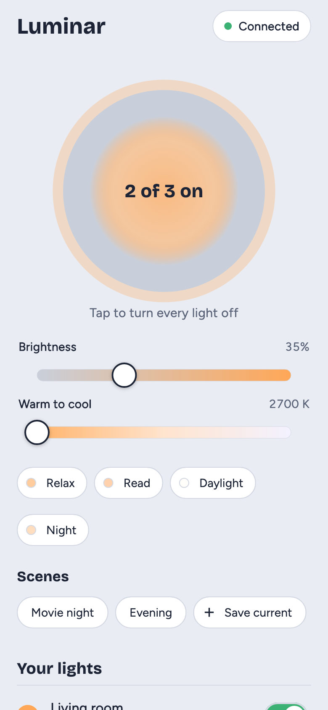
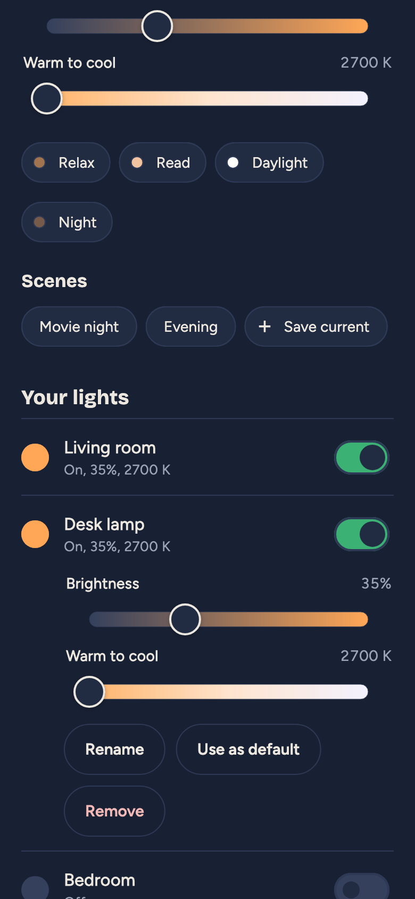
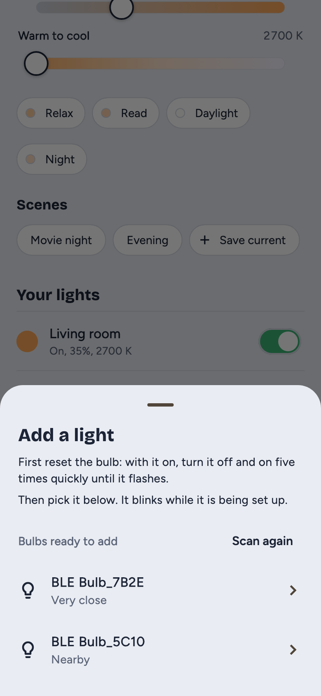

# Luminar

Luminar is an Android app that sets up and controls Sengled Dual Mode Bluetooth Mesh bulbs without Sengled's apps or nRF Mesh. It creates its own mesh network, adds bulbs to it, and controls on/off, brightness, color temperature, and scenes.

<p>
  
  
  
</p>

## Features

- **Setup without other apps:** Luminar adds a reset bulb to its own network in about 10 seconds.
- **All lights at once:** the lamp button, sliders, presets, and scenes reach every bulb in one group message, so they change together.
- **Each light on its own:** on/off, brightness, warmth, rename, remove, and a power-on default.
- **Scenes:** save the current look of every light and bring it back with one tap.
- **Reset detection:** a bulb reset with its light switch shows **Was reset**, and **Set up again** keeps its name and place in the list.
- **Android widgets and app shortcuts:** switch lights or pick a preset from the home screen without opening the app.
- **Fast reconnect:** Luminar connects to your lights in about 4 seconds when it opens.
- **Backups:** a backup code restores your lights on another phone, or in the Lamplight web app.

The original handoff, the Lamplight web app and its JS mesh core live in a local `reference/` folder that isn't in this repository. `test/support/js_vectors.json` holds the vectors generated from that core, so the tests don't need it.

## Install on your phone

1. Build the APK:

   ```bash
   flutter build apk --release
   ```

2. Copy `build/app/outputs/flutter-apk/app-release.apk` to the phone and open it. Allow installs from that source when Android asks.

   Without an upload key, the APK is signed with the debug key. That's fine for installing it yourself. To publish on Play, see [Release (Android)](#release-android).

3. Open Luminar and allow **Nearby devices** when asked.

## Add a bulb

1. Reset the bulb: with it on, turn it off and on five times quickly until it flashes.
2. Tap **Add a light** and pick the bulb (`BLE Bulb_XXXX`). The bulb blinks while Luminar sets it up.

A bulb that's still in another network, such as one set up with nRF Mesh, doesn't appear under **Add a light**. If Luminar connects to one, it tells you to reset it.

### Bulbs reset outside the app

Luminar recognizes your bulbs by their Bluetooth address. When one of them advertises as a new bulb, Luminar marks its light **Was reset**. Tap **Set up again** to add it back with the same name and place in the list. **Add a light** also labels a reset bulb with the light it used to be.

## Debugging with real bulbs

**Activity log** (at the bottom of the main screen) shows every provisioning and network PDU in both directions, plus decoded access messages. Use **Share** to send it somewhere. The bulb's Composition Data is logged when it's configured.

## Widgets and app shortcuts (Android)

Luminar offers two home-screen widgets:

- **Lights on/off** (1×1) toggles every light.
- **Lights and presets** (4×1) adds Relax, Read, Daylight, and Night.

Long-press the app icon for the same actions as app shortcuts. You can drag a shortcut onto the home screen as its own icon. Some launchers show only four shortcuts, so Night appears only when you add it to the home screen.

Widgets and shortcuts run their action without opening the app.

A tap runs `lib/widget_entry.dart` in a background isolate (`home_widget`):
- If Luminar is running, the tap is handed to it over the isolate name server and uses its open connection. That takes about 0.1 s.
- Otherwise the isolate connects, sends one group message and disconnects. That takes about 5–6 s, most of it Android starting the process and opening the Bluetooth link.

The widget shows **…** while it works and **Retry** if no light was in range. The native side is `LuminarWidgets.kt` and `ShortcutActivity.kt` in `android/app/src/main/kotlin/app/luminar/luminar/`. Shortcuts are declared in `android/app/src/main/res/xml/shortcuts.xml`.

Force-stopping Luminar in Android settings turns its widgets off until you open the app again. That's an Android rule for force-stopped apps.

## Backups

**Back up lights** produces a `LAMPLIGHT1:` code that also works in the Lamplight web app. Restoring adds 100,000 to the sequence number so bulbs don't reject messages as replays.

## Architecture

Layered as the Flutter architecture guide recommends: views and view models (MVVM) on top of repositories and services, with use cases for flows that span repositories.

| Path | What it does |
|---|---|
| `lib/data/mesh/` | Pure Dart Bluetooth Mesh protocol: key derivation (s1, k1–k4), network PDUs with obfuscation, segmentation and reassembly, proxy SAR, provisioning math, and access messages for every SIG model the bulbs expose. |
| `lib/data/services/` | Wrappers around the outside world. `BleService` (with the `flutter_reactive_ble` implementation) scans and opens GATT links. `MeshProxyService` is the proxy connection: network and transport layers, request/reply matching, segment acks, group sends. `ProvisioningService` runs PB-GATT. `HomeStore` persists the home in the keystore. `HomeWidgetService` draws the widgets. `ActivityLog` records every PDU. |
| `lib/data/repositories/` | The single sources of truth. `HomeRepository` (keys, lights, scene names, SEQ), `ConnectionRepository` (finding our proxy, connecting, noticing reset bulbs), `LightRepository` (configuration, the All lights group, control, CTL setup, scheduler, what the lights report), `SceneRepository`, `ProvisioningRepository` (scanning for and provisioning new bulbs), `WidgetRepository` (widget state, and taps passed between isolates). |
| `lib/domain/models/` | Immutable models (`freezed`): `Home`, `Light`, `LightState`, plus `Preset`, `NearbyBulb`, and `WidgetAction`. |
| `lib/domain/use_cases/` | `AddLightUseCase` (provision, reconnect as proxy, configure), `ConnectUseCase` (connect, then finish setups and sync states), and `WidgetActionUseCase` (a widget tap while the app isn't running). |
| `lib/widget_entry.dart` | The background entry point for widget and shortcut taps. |
| `lib/ui/features/` | One folder per feature (`home`, `add_light`, `activity_log`), each with `view_models/` and `views/`. View models own the user-facing messages; repositories return typed results. |
| `lib/ui/core/` | Theme and shared widgets. |
| `lib/config/dependencies.dart` | The object graph, provided to the widget tree with `provider`. Tests build the same graph over simulated bulbs. |
| `test/` | Mirrors `lib/`. Spec vectors and cross-checks against the verified JS core, Node's ECDH and Silvair's Python library; repository and view model tests against simulated bulbs that relay over a simulated mesh (`test/support/mock_bulb.dart`, `test/support/harness.dart`). |

After changing a `freezed` model, regenerate with `dart run build_runner build --delete-conflicting-outputs`.

### Supported models

At setup, Luminar reads each bulb's Composition Data and binds its AppKey to every model it supports:

- Generic OnOff
- Light Lightness
- Light CTL
- Light CTL Setup: temperature range and default state
- Scene and Scene Setup: store, recall, register, delete
- Scheduler and Scheduler Setup: register and actions

The vendor model (`0x05040000`) is undocumented. `LightRepository.sendRaw` can send it raw bytes.

The bulbs don't expose a Time Server, and the Scheduler needs one to know the current time, so schedules may never fire. The Scheduler messages are implemented and tested against the simulated bulb. Test them on real hardware before building a schedules screen.

### Packages and why

| Need | Choice | Notes |
|---|---|---|
| BLE | `flutter_reactive_ble` | BSD license and actively maintained. We didn't use `flutter_blue_plus` 2.x because of its non-BSD license and build-time telemetry ping. |
| Mesh protocol | Own pure Dart (`lib/data/mesh/`) | We didn't use `nrf_mesh_flutter`. It's 5 months old, has one maintainer, has gone through 6 major versions, and has an open provisioning bug. Its Android side also depends on an alpha Nordic BLE library. It would also hide the PDU-level logging that real-bulb debugging needs. |
| AES, CMAC, CCM, ECDH P-256 | `pointycastle` | The mesh key derivation functions are built on top of it. |
| Slider throttling | `dart_debounce_throttle` (`ThrottleDebouncer`) | |
| Immutable models | `freezed` | `copyWith`, equality and unmodifiable collections. JSON stays hand-written with pattern matching, to keep the web app's backup format exact. |
| Dependency injection | `provider` | Recommended by the Flutter architecture guide. |
| Key storage | `flutter_secure_storage` | |
| Permissions | `permission_handler` | |
| Sharing backup codes and logs | `share_plus` | |
| Fonts | `google_fonts` | Figtree and Bricolage Grotesque are bundled in `google_fonts/`, so the app never fetches fonts at runtime. |

## Release (Android)

### One-time: create the upload key

Choose your own password when `keytool` asks for one. Keep the `.jks` file and its password somewhere safe, such as a password manager and an offline backup. Play needs this key for every future update.

```bash
keytool -genkeypair -v -keystore ~/luminar-upload.jks -keyalg RSA -keysize 2048 -validity 10000 -alias upload
```

Then create `android/key.properties`. It's git-ignored.

```properties
storeFile=/Users/you/luminar-upload.jks
storePassword=…
keyAlias=upload
keyPassword=…
```

Without this file, release builds are signed with the debug key. They install on a phone for testing, but Play rejects them.

### Build

1. Bump `version:` in `pubspec.yaml`. The part after `+` is the Play version code and must go up with every upload.
2. Build the bundle:

   ```bash
   flutter build appbundle --release
   ```

3. Upload `build/app/outputs/bundle/release/app-release.aab` in the Play Console.

### Icon and splash

They're rendered by `tool/brand/render_brand_assets.dart` into `assets/brand/`, then generated for each platform:

```bash
flutter test tool/brand/render_brand_assets.dart
```

```bash
dart run flutter_launcher_icons
```

```bash
dart run flutter_native_splash:create
```

### Play listing notes

- **Permissions:** Nearby devices (Bluetooth scan and connect, never used for location). Android 11 and lower also need location for scanning. There's no internet permission in release builds.
- **Data safety:** no data is collected or shared. Network keys and the light list stay in the Android keystore on the phone. Backup codes leave the phone only when you share one.

## Development

Run the tests:

```bash
flutter test
```

To regenerate the README screenshots in `docs/screenshots/`, run the app against simulated bulbs:

```bash
flutter test tool/screenshots/take_screenshots.dart
```

`compileSdk` is 37 because `permission_handler` and `flutter_reactive_ble` require it. `targetSdk` follows Flutter's default.
